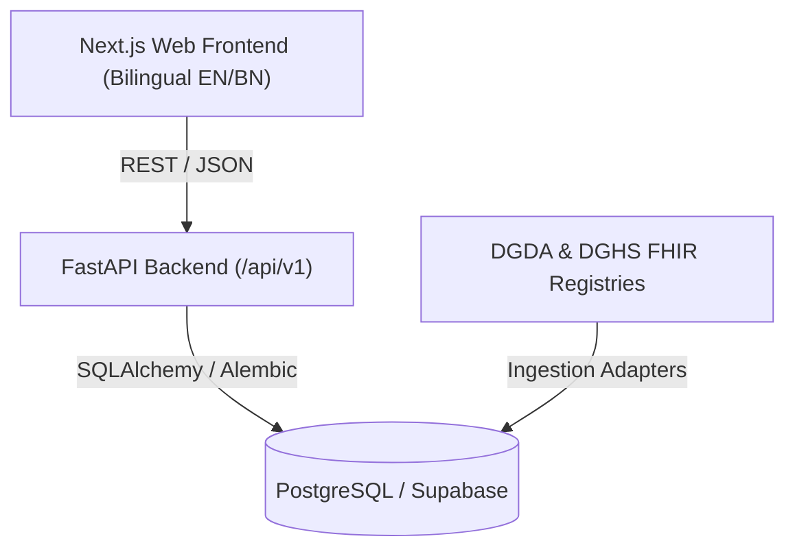

# MediCompare BD System Architecture

## 1. High-Level Architecture

## 2. Core Subsystems
1. **Frontend Presentation Layer**:
   - Modern App Router with responsive grid layout.
   - Design tokens: Primary Navy `#102A43`, Primary Teal `#0D9488`, Accent Mint `#5EEAD4`, Background `#F7FAFC`.
   - Internationalization (i18n): Client-side locale state with full English/Bangla dictionaries.
   - Interactive components: Search autocomplete, real-time generic matcher, dynamic savings calculator, comparison matrix.

2. **Backend Services Layer**:
   - `search_service`: Trigram and full-text search across brands, generics, and therapeutic classes.
   - `matching_service`: Strict multi-ingredient composition, dosage form, and strength normalization.
   - `savings_service`: Unit price calculation and regimen cost savings estimation.
   - `verification_service`: DGDA registration tracking, verification confidence scoring, and provenance audit.

3. **Data Schema & Models**:
   - `manufacturers`: Name, license, DGDA registration, quality certifications.
   - `generics`: Generic INN name, therapeutic class, standard indications summary.
   - `medicines`: Brand name, generic_id, dosage_form, strength, pack_size, mrp, verification_status.
   - `ingredients`: Active pharmaceutical ingredients (API) breakdown.
   - `price_records`: Historical price movements and verification audits.
